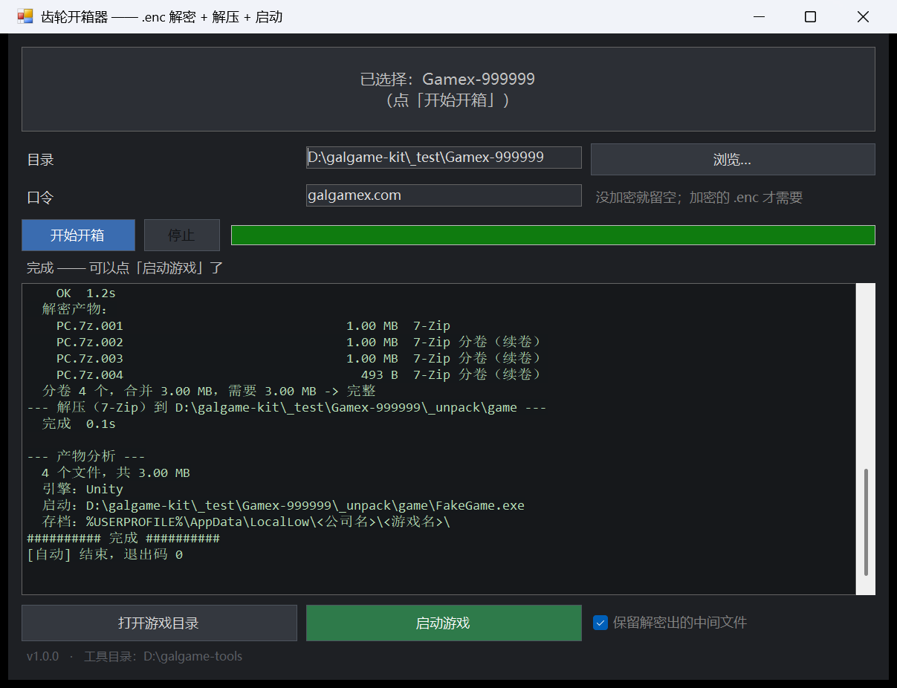

# 齿轮开箱器 · GalgameKit

把从某些资源站下载的 **`.enc` 加密分卷** 一路变成 **双击就能玩的游戏**：解密 → 合并分卷 → 解压 → 自动认出引擎和启动程序。

Windows / .NET Framework 4.x（系统自带，不用装任何运行时）。图形界面 + 命令行 + 可引用的类库。



---

## 它解决什么问题

资源站为了防和谐、防搬运，常把游戏包成两层：

```
PC.001.enc  PC.002.enc         ← 第一层：站点自己的加密容器（魔数 SSEFE）
        ↓ 用站点口令解开
PC.001      PC.002             ← 第二层：7-Zip 分卷（.001/.002 是同一份 7z 的切片）
        ↓ 正常解压
MyGame\                        ← 游戏本体，解压即玩，没有安装器
```

手动做这件事的麻烦点在于：

- `.enc` 不是压缩包，**7-Zip / WinRAR 直接开一定失败**，得先知道它是什么容器、用什么工具；
- 解密出来的分卷如果少了一卷，7-Zip 会解到一半才报错，白等几十分钟；
- 解出来以后还得自己在几千个文件里找出哪个 exe 是启动器。

这个工具把三层判断都做完了，并且**在动手之前**就把能提前发现的问题报出来。

## 不放心的可以先看这几条

- **不联网**。整个程序没有任何网络代码，不上传、不校验、不遥测。口令只用于本地解密。
- **口令不落盘**。解密时口令写进临时文件后立即删除，不经过命令行参数（命令行对整个系统可见），跑完即弃，不写进任何配置。
- **不改动源文件**。所有产物都放在源目录下的 `_unpack\`，原始 `.enc` 原样保留。想删随时整个删掉。
- 单文件绿色程序，80 KB，可与工具目录一起拷到任意机器。

## 快速开始

### 1. 准备工具目录

程序自己不做解密和解压，它调用两个成熟的第三方命令行工具。把它们放在**同一个目录**里：

```
galgame-kit\
  齿轮开箱器.exe          ← 本程序
  galgame-kit-cli.exe
  7z.exe                 ← 7-Zip 的独立命令行版
  7z.dll
  ssefenc.jar            ← S.S.E. File Encryptor 的 CLI
  jre\bin\java.exe       ← 一份 JRE（ssefenc 需要 Java）
```

- `7z.exe` / `7z.dll`：<https://www.7-zip.org/download.html>（"7-Zip Extra" 或主安装包解出来的）
- `ssefenc.jar` + JRE：<https://paranoiaworks.mobi/download/>（"S.S.E. File Encryptor for PC"）
- 也可以只放 `7zr.exe`（7-Zip Extra 里的小体积版），但它**只认 .7z，不认 zip/rar**。

工具放别处也行，设环境变量 `GALGAMEKIT_TOOLS` 指向那个目录即可。
程序也兼容这些老布局：`admin\...\runtime\bin\java.exe`、`S.S.E. File Encryptor for PC\ssefenc.jar`。

### 2. 用图形界面

双击 `齿轮开箱器.exe` → 把下载的文件夹拖进窗口 → 口令填上 → 「开始开箱」→ 完成后点「启动游戏」。

### 3. 用命令行

```bat
galgame-kit-cli.exe -p 你的口令 "D:\Downloads\Gamex-123456"
galgame-kit-cli.exe --dry-run "D:\Downloads\Gamex-123456"      :: 只看会做什么
galgame-kit-cli.exe -p 口令 --clean "D:\Downloads\Gamex-123456" :: 解完删掉中间文件
```

退出码：`0` 成功 / `1` 失败 / `2` 参数错误。加 `--json` 输出结构化结果，方便接到自己的脚本里。

### 4. 当成库用

```csharp
using GalgameKit.Core;

ToolSet tools = ToolSet.Locate(AppDomain.CurrentDomain.BaseDirectory);
var pipe = new UnpackPipeline(tools, new Options { Password = "…" });
UnpackOutcome r = pipe.Run(@"D:\Downloads\Gamex-123456", myReporter);

if (r.Playable) Process.Start(r.Launcher);
```

`IReporter` 是唯一的输出接口，接控制台、接 WinForms、接日志文件、接 xUnit 都行 —— 核心逻辑不依赖 UI。

## 它认识什么

| 容器 | 识别方式 | 说明 |
|---|---|---|
| `.enc`（SSEFE） | 8 字节魔数 `SSEFE` + 版本 | Paranoia Works 系加密容器，需要口令 |
| 7-Zip 分卷 | `.7z` 主头 + `.001/.002/…` 命名 | 能**在解压前**精确校验分卷是否齐全 |
| ZIP / RAR | 魔数 | 走 7z.exe |
| XP3 / UnityFS / CPK / NEKOPACK | 魔数 | 只做识别与提示，不代解 |

| 引擎 | 判据 | 存档位置提示 |
|---|---|---|
| Unity | `UnityPlayer.dll` | `%USERPROFILE%\AppData\LocalLow\<公司>\<游戏>\` |
| Godot | `*.pck` / `*.console.exe` / `godot.log` | 同上 |
| RPG Maker VX Ace / XP | `RGSS301.dll` / `RGSS202E.dll` | `游戏目录\Save\` |
| RPG Maker MV/MZ | `nw.dll` / `package.json` | 同上 |
| KiriKiri | `*.xp3` | `%USERPROFILE%\Documents\<游戏>\` |
| Ren'Py | `*.rpy` / `*.rpa` | `%USERPROFILE%\AppData\Roaming\<游戏>\` |

## 分卷完整性校验是怎么做的

7z 的主头里有两个字段：`NextHeaderOffset`（+12）与 `NextHeaderSize`（+20）。真正的文件末尾位置是

```
32 + NextHeaderOffset + NextHeaderSize
```

把它和同组所有分卷的字节数之和比一下：相等就是齐的，不相等就报出**还缺多少字节**。这一步在解压之前完成，所以不会出现"解了 40 分钟才告诉你少一卷"。

ZIP / RAR 没有等价字段，只能解了才知道，工具会如实说明这一点而不是假装能校验。

## 长路径

Windows 的经典路径上限是 260 个字符，超过之后 `Directory.GetFiles` **不抛异常，而是悄悄返回空**。这类 bug 的表现是"文件数比预期少"，极难查。

本项目的处理：

1. `PathHelper.Long()` 对超过 260 字符的路径加 `\\?\` 前缀（UNC 用 `\\?\UNC\`）。
2. `.NET Framework` 默认连 `\\?\` 也不认，会报"路径中具有非法字符"。所以每个 exe 旁边必须有一份 `.exe.config`，里面打开两个开关：

```xml
<runtime>
  <AppContextSwitchOverrides value="Switch.System.IO.UseLegacyPathHandling=false;Switch.System.IO.BlockLongPaths=false" />
</runtime>
```

`scripts/build.ps1` 会把 `src/app.config` 复制成三份 `.exe.config`。**如果你手动拷走 exe 而忘了配置文件，长路径支持就静默失效了** —— 单元测试里有一条会真的造一个 300 字符的目录来验证这件事。

3. 枚举结果在返回前会去掉 `\\?\` 前缀，因为 `7z.exe` / `java.exe` 不认这个前缀。

## 项目结构

```
src/Core/          纯逻辑，零 UI 依赖
  FileSignatures.cs   魔数表 → ContainerKind
  VolumeGroup.cs      分卷分组、7z 完整性校验、自然排序
  ProcessRunner.cs    子进程 + 实时进度 + 取消 + 尾部输出
  UnpackPipeline.cs   主流程
  EngineDetector.cs   引擎识别 + 启动器挑选
  ToolSet.cs          工具定位（相对 exe / 环境变量 / 老布局回退）
  PathHelper.cs       长路径、大小格式化
  IReporter.cs        输出接口
src/Cli/           命令行前端
src/Gui/           WinForms 前端（单文件编译，把 Core 源码一起编进去）
src/Tests/         零依赖测试跑器（不带 xUnit/NUnit，随便哪台机器的 csc 都能编）
src/app.config     长路径开关，build.ps1 负责复制到 dist\
scripts/build.ps1  一条命令编译四个产物
scripts/shot.ps1   DPI 感知截图（做文档截图用）
docs/              说明文档与截图
```

## 编译

不需要 Visual Studio，也不需要 .NET SDK —— 用 Windows 自带的 `csc.exe`：

```powershell
powershell -NoProfile -ExecutionPolicy Bypass -File scripts\build.ps1 -Test
```

产物落在 `dist\`。`-Clean` 先清空；`-Test` 编完跑冒烟测试 **和** 82 条单元测试；`-NoTests` 跳过测试编译。

单独跑测试：

```powershell
dist\galgame-kit-tests.exe            :: 全部
dist\galgame-kit-tests.exe VolumeGroup :: 只跑名字含 VolumeGroup 的
```

> 注意：如果你想改 `.ps1` 脚本并且用 Windows PowerShell 5.1 运行，**文件必须存成 UTF-8 with BOM**，否则 PS 5.1 会按 GBK 解释，报一堆 `Unexpected token`。

## 已知限制

- 只做 Windows。核心逻辑本身是纯 .NET，但启动器挑选、路径习惯都是 Windows 的。
- `7zr.exe` 不支持 zip/rar，缺 `7z.exe` 时只能处理 .7z。
- ZIP / RAR 分卷无法预校验，只能解压后发现。
- 引擎识别是**启发式**的，认不出来会如实说"未知"而不是瞎猜。
- 不处理压缩包自带的第二层密码（`.enc` 的口令和 zip 密码不是一回事）。
- 图形界面没有做 i18n，文案是中文写死的。`IReporter` 已经抽出来了，要加多语言主要改 GUI 层。

## 许可

MIT，见 [LICENSE](LICENSE)。

第三方工具不随本仓库分发，各自遵循其原许可证：

- 7-Zip — GNU LGPL + unRAR restriction
- S.S.E. File Encryptor / Paranoia Works — 见其官网授权条款
